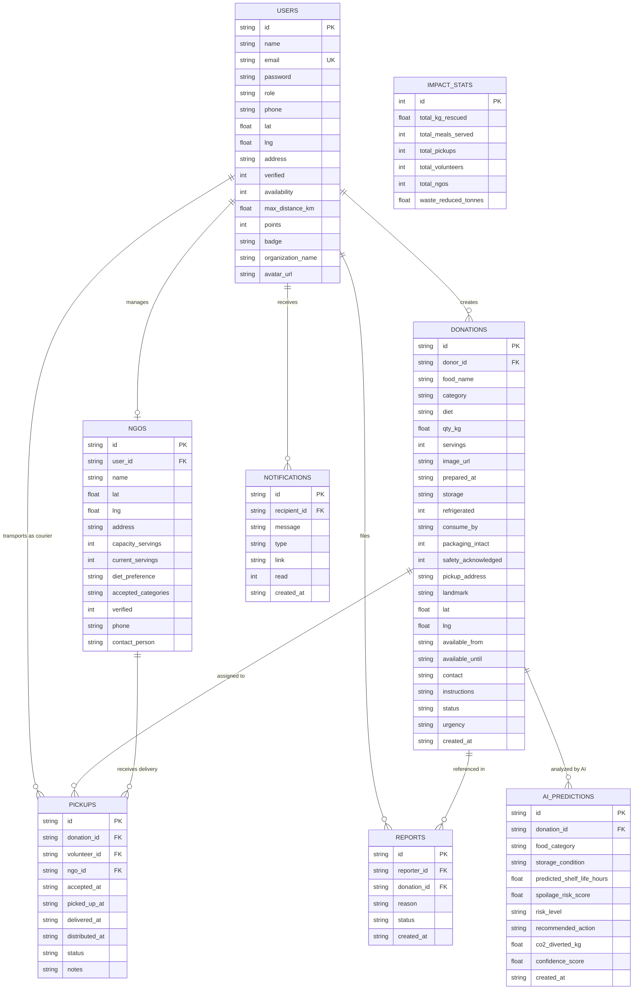

# FoodSave AI — Database Architecture & Developer Reference

> **Database Role Reference Guide**  
> **Database Engine:** SQLite (Native `node:sqlite` via WAL mode)  
> **Schema File:** [`server/schema.sql`](file:///C:/Users/TUF%20A15%20HN007WS/.gemini/antigravity/scratch/foodbridge-ai/server/schema.sql)  
> **Connection Entry:** [`server/db.js`](file:///C:/Users/TUF%20A15%20HN007WS/.gemini/antigravity/scratch/foodbridge-ai/server/db.js)  
> **AI Prediction Module:** [`server/ai/prediction.js`](file:///C:/Users/TUF%20A15%20HN007WS/.gemini/antigravity/scratch/foodbridge-ai/server/ai/prediction.js)

---

## 1. Entity-Relationship (ER) Diagram

The diagram below illustrates how all 8 tables connect through Primary Keys (`PK`) and Foreign Keys (`FK`):



---

## 2. Data Dictionary (Table Specifications)

### 2.1. `users` Table
Stores authentication accounts and profiles for all user roles.

| Column | Type | Constraints | Description |
|---|---|---|---|
| `id` | TEXT | PRIMARY KEY | Unique ID (e.g. `'user-donor-demo'`) |
| `name` | TEXT | NOT NULL | User's full name or business contact |
| `email` | TEXT | UNIQUE, NOT NULL | Account login email |
| `password` | TEXT | NOT NULL | Hashed security password |
| `role` | TEXT | NOT NULL | `'donor'`, `'volunteer'`, `'ngo'`, or `'admin'` |
| `phone` | TEXT | NOT NULL | Contact telephone |
| `lat` | REAL | NOT NULL | Geolocation latitude coordinate |
| `lng` | REAL | NOT NULL | Geolocation longitude coordinate |
| `address` | TEXT | NOT NULL | Street or operating address |
| `verified` | INTEGER | DEFAULT 1 | 1 = email/identity verified, 0 = pending |
| `availability`| INTEGER | DEFAULT 1 | 1 = active / open for courier jobs, 0 = offline |
| `max_distance_km`| REAL | DEFAULT 15.0 | Max delivery travel radius in kilometers |
| `points` | INTEGER | DEFAULT 0 | Gamification points for completed deliveries |
| `badge` | TEXT | DEFAULT 'Food Saver' | Gamification title (e.g. 'Food Champion', 'FoodBridge Legend') |
| `organization_name`| TEXT | NULLABLE | Business or restaurant name (Bella Vista Restaurant) |
| `avatar_url` | TEXT | NULLABLE | Profile picture URL |

---

### 2.2. `donations` Table
Surplus food offerings posted by restaurants, bakeries, or caterers.

| Column | Type | Constraints | Description |
|---|---|---|---|
| `id` | TEXT | PRIMARY KEY | Unique donation ID (e.g. `'don-101'`) |
| `donor_id` | TEXT | NOT NULL, FK(`users.id`) | Creator user ID (cascades on delete) |
| `food_name` | TEXT | NOT NULL | Name/description of surplus food |
| `category` | TEXT | NOT NULL | `'cooked'`, `'bakery'`, `'raw_produce'`, `'packaged'`, `'dairy'` |
| `diet` | TEXT | NOT NULL | `'veg'`, `'non-veg'`, or `'vegan'` |
| `qty_kg` | REAL | NOT NULL | Surplus quantity in kilograms |
| `servings` | INTEGER | NOT NULL | Calculated meal equivalents ($15\text{ kg} \approx 35\text{ meals}$) |
| `image_url` | TEXT | NULLABLE | Photo link of surplus food |
| `prepared_at` | TEXT | NOT NULL | ISO 8601 preparation timestamp |
| `storage` | TEXT | DEFAULT 'ambient' | `'ambient'`, `'refrigerated'`, or `'frozen'` |
| `refrigerated` | INTEGER | DEFAULT 0 | 1 = requires active cold chain box |
| `consume_by` | TEXT | NOT NULL | Strict freshness deadline |
| `packaging_intact`| INTEGER | DEFAULT 1 | Food hygiene check (1 = pass) |
| `safety_acknowledged`| INTEGER | NOT NULL | Legal declaration acceptance (1 = agreed) |
| `pickup_address` | TEXT | NOT NULL | Street address where food is located |
| `landmark` | TEXT | NULLABLE | Gate number, floor, or parking instructions |
| `lat` / `lng` | REAL | NOT NULL | Exact GPS coordinates for navigation |
| `available_from` | TEXT | NOT NULL | Earliest courier pickup time |
| `available_until` | TEXT | NOT NULL | Hard cutoff pickup time |
| `contact` | TEXT | NOT NULL | Dispatch phone number |
| `instructions` | TEXT | NULLABLE | Chef notes (e.g. "Bring insulated tote bag") |
| `status` | TEXT | DEFAULT 'Created' | `'Created'`, `'Matched'`, `'Picked Up'`, `'Delivered'`, `'Cancelled'` |
| `urgency` | TEXT | DEFAULT 'medium' | Calculated status: `'low'`, `'medium'`, `'high'`, `'critical'` |
| `created_at` | TEXT | NOT NULL | ISO 8601 creation timestamp |

---

### 2.3. `pickups` Table
Connects a donation, a courier (volunteer), and a charity (NGO).

| Column | Type | Constraints | Description |
|---|---|---|---|
| `id` | TEXT | PRIMARY KEY | Unique pickup task ID |
| `donation_id` | TEXT | NOT NULL, FK(`donations.id`) | Food listing reference |
| `volunteer_id` | TEXT | NULLABLE, FK(`users.id`) | Assigned courier ID |
| `ngo_id` | TEXT | NULLABLE, FK(`ngos.id`) | Destination charity ID |
| `accepted_at` | TEXT | NULLABLE | Timestamp courier accepted route |
| `picked_up_at`| TEXT | NULLABLE | Timestamp courier scanned food at donor |
| `delivered_at`| TEXT | NULLABLE | Timestamp food arrived at charity |
| `distributed_at`| TEXT | NULLABLE | Timestamp meals were distributed |
| `status` | TEXT | NOT NULL | `'Assigned'`, `'In Transit'`, `'Delivered'`, `'Completed'` |
| `notes` | TEXT | NULLABLE | Proof of delivery or notes |

---

### 2.4. `ngos` Table
Charity and hunger-relief distributions.

| Column | Type | Constraints | Description |
|---|---|---|---|
| `id` | TEXT | PRIMARY KEY | Unique NGO ID |
| `user_id` | TEXT | NULLABLE, FK(`users.id`) | Linked coordinator user account |
| `name` | TEXT | NOT NULL | NGO name (e.g. "Green Hope Foundation") |
| `lat` / `lng` | REAL | NOT NULL | Center coordinates |
| `address` | TEXT | NOT NULL | Shelter physical address |
| `capacity_servings`| INTEGER | DEFAULT 250 | Max storage capacity for meal portions |
| `current_servings` | INTEGER | DEFAULT 0 | Active inventory |
| `diet_preference` | TEXT | DEFAULT 'any' | Diet compatibility ('veg', 'any') |
| `accepted_categories`| TEXT | DEFAULT JSON string | Allowed food types (array serialized as JSON) |
| `verified` | INTEGER | DEFAULT 1 | 1 = background-checked nonprofit |
| `phone` | TEXT | NOT NULL | Operations hotline |
| `contact_person` | TEXT | NOT NULL | Shelter head coordinator |

---

### 2.5. `ai_predictions` Table (New - AI Food Spoilage & Waste Reduction)
Stores AI analysis results for shelf life, spoilage probabilities, and carbon diversion metrics.

| Column | Type | Constraints | Description |
|---|---|---|---|
| `id` | TEXT | PRIMARY KEY | Unique prediction ID (`'pred-a1b2c3d4'`) |
| `donation_id` | TEXT | NULLABLE, FK(`donations.id`) | Linked donation listing |
| `food_category` | TEXT | NOT NULL | Normalized category (`'cooked'`, `'dairy'`, etc.) |
| `storage_condition` | TEXT | NOT NULL | `'ambient'`, `'refrigerated'`, `'frozen'` |
| `predicted_shelf_life_hours` | REAL | NOT NULL | Hours remaining before microbial spoilage risk exceeds 50% |
| `spoilage_risk_score` | REAL | NOT NULL | Probability of spoilage ($0.00$ to $1.00$) |
| `risk_level` | TEXT | NOT NULL | `'low'`, `'moderate'`, `'high'`, `'critical'` |
| `recommended_action` | TEXT | NOT NULL | Actionable advice for dispatch & couriers |
| `co2_diverted_kg` | REAL | NOT NULL | Estimated CO2 emissions avoided by rescue ($2.5 \times \text{kg}$) |
| `confidence_score` | REAL | DEFAULT 0.90 | AI model confidence rating |
| `created_at` | TEXT | NOT NULL | ISO 8601 prediction timestamp |

---

### 2.6. `notifications`, `reports`, and `impact_stats`
* **`notifications`**: System alerts (`recipient_id`, `message`, `type`, `read`, `created_at`).
* **`reports`**: Safety flags, spoilages, or disputes (`reporter_id`, `donation_id`, `reason`, `status`).
* **`impact_stats`**: High-level impact summary row (`total_kg_rescued`, `total_meals_served`, `total_pickups`, `total_volunteers`, `total_ngos`, `waste_reduced_tonnes`).

---

## 3. Ready-To-Use SQL Query Recipes for Backend Developers

Backend teammates can copy and paste these parameterized SQL queries directly into their route handlers using Node.js:

### Recipe 1: Authenticate User by Email
```sql
SELECT id, name, email, password, role, organization_name, points, badge 
FROM users 
WHERE email = ?;
```

### Recipe 2: Get Available Donations for Courier Feed (Sorted by Urgency)
```sql
SELECT id, food_name, category, diet, qty_kg, servings, pickup_address, landmark, lat, lng, available_until, urgency, created_at
FROM donations
WHERE status = 'Created'
ORDER BY 
  CASE urgency
    WHEN 'critical' THEN 1
    WHEN 'high' THEN 2
    WHEN 'medium' THEN 3
    ELSE 4
  END ASC,
  available_until ASC;
```

### Recipe 3: Volunteer Accepts a Food Rescue
```sql
-- Step 1: Update donation status
UPDATE donations 
SET status = 'Matched' 
WHERE id = ? AND status = 'Created';

-- Step 2: Create pickup record
INSERT INTO pickups (id, donation_id, volunteer_id, ngo_id, accepted_at, status)
VALUES (?, ?, ?, ?, datetime('now'), 'Assigned');
```

### Recipe 4: Mark Delivery Complete & Award Gamification Points
```sql
-- Step 1: Update pickup timestamp
UPDATE pickups
SET delivered_at = datetime('now'), status = 'Delivered'
WHERE id = ?;

-- Step 2: Award +10 points to volunteer
UPDATE users
SET points = points + 10
WHERE id = ?;

-- Step 3: Update global impact stats
UPDATE impact_stats
SET total_kg_rescued = total_kg_rescued + ?,
    total_meals_served = total_meals_served + ?,
    total_pickups = total_pickups + 1
WHERE id = 1;
```

### Recipe 5: Find Compatible NGOs Within Capacity
```sql
SELECT id, name, address, (capacity_servings - current_servings) AS remaining_capacity, lat, lng
FROM ngos
WHERE verified = 1 
  AND (capacity_servings - current_servings) >= ?
ORDER BY remaining_capacity DESC;
```

### Recipe 6: Retrieve AI Waste & Spoilage Prediction for a Donation
```sql
SELECT 
  d.id AS donation_id,
  d.food_name,
  d.qty_kg,
  p.predicted_shelf_life_hours,
  p.spoilage_risk_score,
  p.risk_level,
  p.recommended_action,
  p.co2_diverted_kg,
  p.confidence_score
FROM donations d
JOIN ai_predictions p ON d.id = p.donation_id
WHERE d.id = ?;
```

---

## 4. Query Performance & Indexes

To keep query response times under **10 milliseconds** even with thousands of listings, the following indexes are enabled in [`server/schema.sql`](file:///C:/Users/TUF%20A15%20HN007WS/.gemini/antigravity/scratch/foodbridge-ai/server/schema.sql):

* `idx_donations_status`: Rapid filtering for `WHERE status = 'Created'`
* `idx_donations_donor_id`: Instant donor history retrieval
* `idx_pickups_donation_id`: Quick lookup for active delivery tracking
* `idx_pickups_volunteer_id`: Fast query for a courier's assigned deliveries
* `idx_notifications_recipient`: Instant unread badge counting (`WHERE recipient_id = ? AND read = 0`)
* `idx_ai_predictions_donation`: Instant AI freshness report retrieval per donation
* `idx_ai_predictions_risk`: Fast filtering of donations at `'critical'` or `'high'` waste risk
